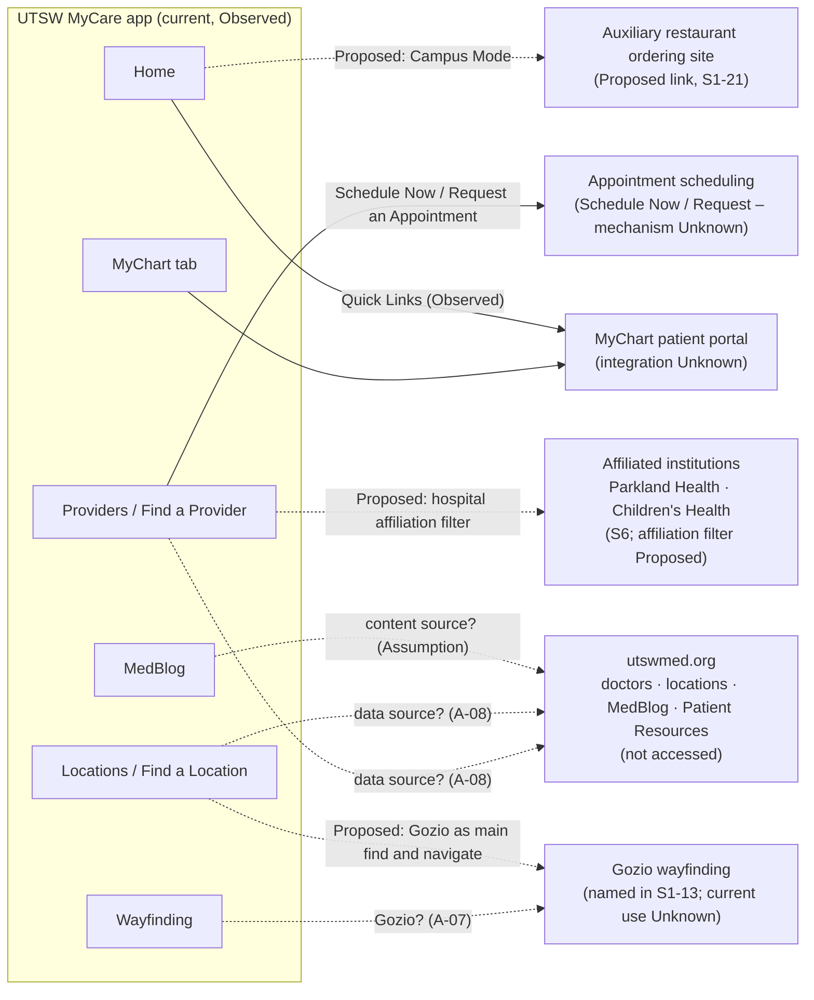

# 1. Product Understanding Brief – MyCare 2.0

| | |
|---|---|
| **Deliverable** | 1 of 7 – Product Understanding Brief |
| **Status** | Draft v0.1 – for client validation. Nothing here is approved scope. |
| **Date** | Oct. 13, 2026 |
| **Sources** | S1 (deck, all 24 slides); S2c (search-engine URL listings only); S3–S7 (brand and editorial standards). **S2a and S2b (utswmed.org/doctors and /locations) could not be accessed** – see section 2. |
| **Evidence mix** | Current-state facts are Confirmed or Observed from S1. Future-state statements are Proposed. Purpose, objectives and users are mostly Assumption or Unknown. |
| **Key assumptions** | A-01 (MyCare 2.0 is the next version of the existing app), A-02 (audience), A-05 (MyChart is the system of record) – see [Register](05-assumptions-risks-register.md). |
| **Decisions required** | Product vision and objectives (Q-01, Q-02); first-release scope (Q-12); audience (Q-04); MyCare–MyChart relationship (Q-05). |

**Evidence key:** **Confirmed** = stated as fact in a provided source · **Observed** = visible in a screenshot or page · **Proposed** = an idea in the deck, not approved · **Assumption** = an interpretation that needs validation · **Unknown** = must come from the client or technical team.

---

## 1. Purpose of this brief

This brief records what the provided materials establish about MyCare 2.0, what they only suggest and what is missing. It is the reference point for scope, architecture and design work. It deliberately contains no screen designs.

## 2. Sources reviewed and access limitations

| ID | Source | Status | What it can and cannot tell us |
|---|---|---|---|
| S1 | *UTSW MyCare 2.0 – Key Features, Experience, Design Elements* (24 slides) | **Reviewed in full.** It was uploaded twice and both files are byte-identical. | The primary evidence for the current app and the proposed ideas. It contains no objectives, metrics, research, scope or technical detail. See [deck evidence log](sources/deck-evidence-log.md). |
| S2a | https://utswmed.org/doctors/ | **Not accessed** | Direct access from this workspace was denied by the environment's network policy (HTTP 403 at the egress proxy). The hosted web-fetch tool could not resolve the domain, and archived copies (web.archive.org) were also blocked. **No content from this page has been reviewed**, so its filters, cards and behavior are not described anywhere in these documents. |
| S2b | https://utswmed.org/locations/ | **Not accessed** | Same as S2a. |
| S2c | Search-engine index listings for utswmed.org (Oct. 13, 2026) | **URL patterns observed only** | Indexed URLs show public provider profile pages (`/doctors/{first-last}/`, e.g. `/doctors/lucas-mcgee/`), location listings keyed by a specialty, condition or service slug (`/locations/all/{id}/{slug}/`, e.g. `family-medicine`, `immunology`, `transplant`, `palliative-care`, `copd`, `hepatitis-c`, `gliomas`, `incontinence`, `pelvic-floor-dysfunction`, `gammapod`), and MedBlog topic pages (`/medblog/topic/heart/`). The page content was not reviewed, and search-engine summaries were **not** used as evidence. |
| S1-22 | Screenshot of the public utswmed.org "Patient Resources" page, inside the deck | Observed (indirectly) | The only view of the public website in the materials. |
| S3–S7 | Brand standards (logo, color, typography) and the *UT Southwestern Style Guide* (June 8, 2026) | Reviewed | Confirmed standards for language, naming and visual identity. See [brand and editorial notes](sources/brand-and-editorial-standards.md). |

**Impact of the website gap:**
- The public web baseline for provider and location discovery is unverified.
- Any comparison between web and app capabilities is on hold.
- Whether the app and the website share data is an Assumption (A-08).

The fix is a network-allowlist change for `utswmed.org` (Q-40). The website review should then be completed and this brief updated.

## 3. What MyCare 2.0 is

| Statement | Evidence |
|---|---|
| UT Southwestern has a patient mobile app branded "UTSW MyCare". Its five tabs are Home, MyChart, Providers, Locations and Wayfinding. | **Observed** (S1-1, S1-6, S1-8, S1-13, S1-17, S1-20) |
| Some UTSW app screens in the deck show a different three-tab bar (Home, Providers, Locations) and a different location model. | **Observed** (S1-14, S1-15). The reason is **Unknown** (Q-23). |
| The deck compares current and future states for Find Care, the provider directory and the provider detail page. It proposes ideas for locations, home, MedBlog, Campus Mode, patient resources, favorites, account settings and campaigns. | **Confirmed** (S1) |
| "Find a Provider" is intended to become "Find Care". | **Assumption** (A-03), from the slide headers "Find a Provider Start → Find Care" |
| MyCare 2.0 is the next version of the existing app rather than a separate product. | **Assumption** (A-01, Q-03) |
| The product vision, objectives, success measures, release scope, platforms and timeline. | **Unknown** (Q-01, Q-02, Q-12, Q-22, Q-38) |

**Working definition (Assumption, for validation):** *MyCare 2.0 is the next version of UT Southwestern's patient mobile app. It helps people find the right care (providers, specialties and locations), get there (directions and wayfinding) and reach their existing patient services (MyChart). Health content supports them before, during and after visits.*

## 4. Business and organizational context

**Confirmed (S6 boilerplate):**
- UT Southwestern is an academic medical center.
- Its physicians practice in more than 80 specialties.
- Each year they care for more than 143,000 hospitalized patients, attend to more than 470,000 emergency room cases and oversee nearly 5.3 million outpatient visits.
- Faculty physicians provide care at William P. Clements Jr. University Hospital, UTSW clinics and affiliated institutions, including Parkland Health and Children's Medical Center Dallas.

**Observed:**
- The current app promotes "#1 hospital in DFW for a decade," citing U.S. News & World Report (S1-17).
- The current app's city filter includes locations outside DFW: Lubbock and Tyler (S1-1).

**Confirmed (S3, S5, S6):** Brand governance sits with the Office of Communications, Marketing, and Public Affairs (CMPA). Editorial style governance sits with the Office of Institutional Advancement.

**Unknown:**
- The product owner, sponsoring department and decision-makers (Q-35, Q-36).
- The business objectives (Q-02).
- The budget, timeline and engineering ownership (Q-37, Q-38).

**Emphasis in the deck (Assumption – not stated objectives).** These suggest candidate objectives the client should confirm or replace, not goals:
1. Making care easier to find and understand, with patient-friendly language (S1-2, S1-7).
2. Turning discovery into appointment actions (S1-7, S1-10).
3. Helping patients get to the right place (S1-13, S1-18).
4. A more personal, engaging home (S1-17 to S1-19, S1-24).

## 5. Users

No user research, analytics or personas were provided (**Unknown**, Q-07).

| User group | Why we think they matter | Evidence |
|---|---|---|
| Prospective or new patients looking for care | The "Accepting new patients" filter and the find-and-schedule emphasis | **Proposed** (S1-2); the audience itself is an **Assumption** (A-02) |
| Existing and returning patients | Quick Links for MyChart tasks; the authenticated home and appointment-card concepts | **Observed** (S1-17); **Proposed** (S1-18) |
| Patients and visitors on campus on the day of a visit | The Wayfinding tab, the Campus Mode bullets and the day-of appointment card | **Observed** (S1-1); **Proposed** (S1-18, S1-21) |
| Caregivers and family members (including pediatric) | Pediatric Group logos exist (S5); proxy access is common in patient portals | **Unknown** – not addressed in S1 (Q-04, Q-29) |
| Referring clinicians | Only in an inspiration reference ("Refer Patient", S1-11) | **Unknown** – not proposed by UTSW (Q-04) |
| Patients who prefer a language other than English | The provider "Languages" filter (S1-2) and "Language preferences?" (S1-24) | **Proposed**. App UI localization is **Unknown** (Q-34). |
| Patients with disabilities | "Accessibility settings" (S1-24) | **Proposed**. The applicable standard is **Unknown** (Q-30). |
| Internal teams (CMPA, service lines, content editors) | Campaign-to-service-line mapping (S1-24); MedBlog content | **Proposed** (S1-24). Content operations are **Unknown** (Q-33). |

## 6. Ecosystem

Solid lines are **Observed** entry points whose integration mechanism is still **Unknown**. Dotted lines are **Proposed** or **Assumption**.

## 7. Understanding by area

Each area records **what exists**, **what is proposed**, **what needs validation** and **what it depends on**. Feature IDs (F-xx) link to the [Feature and Scope Inventory](02-feature-scope-inventory.md). Unknown IDs (U-xx) link to the [Register](05-assumptions-risks-register.md).

### 7.1 Find Care and provider search (F-01, F-06, F-07)
- **Exists (Confirmed S1-1):**
  - Search by "Name, Specialty, Condition".
  - A separate "Zip Code" field.
  - A "Distance from me" button.
  - Search history.
- **Proposed (S1-2, S1-4):**
  - A large search bar as the prominent feature.
  - Search by doctor, specialty, condition, location and zip.
  - "Potentially a toggle for site/clinics vs. providers".
- **Validate:**
  - Whether the search service supports conditions, synonyms, typeahead and location queries (U-05).
  - Whether "Find Care" replaces "Providers" in navigation (A-03).
- **Depends on:** the search service (U-05), the provider and location data source (U-03, U-04), and location permission (F-23).

### 7.2 Search filters, specialty discovery and popular searches (F-02 to F-05, F-08)
- **Exists (Confirmed S1-1):**
  - The academic division list is the main filter.
  - City is the only other filter, with 10 cities listed (Observed).
- **Proposed (S1-2):**
  - Filters for gender, languages, online scheduling, hospital affiliation (default UTSW only), distance ranges, accepting new patients and provider type. Provider type is missing on S1-4.
  - Icon or segmented specialty selection.
  - A scrolling filter bar.
  - "Popular searches?" (marked as a question).
- **Observed reference only:** a "Sort results by" sheet (S1-5). It is not annotated, so it is not a proposal.
- **Validate:**
  - Which filter attributes exist as structured data (U-03).
  - What "Hospital affiliation" covers (Q-16).
  - What "Gender" refers to (A-10).
  - Who owns the specialty taxonomy (Q-14).
  - The source for popular searches (Q-08).
- **Depends on:** provider data quality (R-02), search analytics (U-11) and the taxonomy owner (U-06).

### 7.3 Provider directory and result cards (F-09)
- **Exists (Confirmed S1-6):**
  - Name with credentials, photo, academic division, primary location and address, distance, and a "Schedule Now" or "Request an Appointment" button.
- **Proposed (S1-7):**
  - Name, photo, academic division, appointment action and distance (the address is dropped).
  - Explore: more contrast or segmentation, "action type buttons vs. information", specialty instead of academic division, and "less is more – let the filters do the work".
- **Validate:**
  - The internal conflict between keeping academic division and replacing it with specialty (K-03).
  - Which location distance is measured from for providers with several locations (Q-24).
- **Depends on:** the appointment action rules (Q-15) and specialty data (U-06).

### 7.4 Provider detail and clinical information (F-10, F-11, F-12)
- **Exists (Confirmed S1-8):**
  - Name, credentials and photo.
  - Academic department and division.
  - Biography and education.
  - Clinical specialties and areas of focus.
  - Research content and media.
  - Video where applicable.
  - Primary and secondary locations with addresses and phone numbers.
  - Request or schedule.
  - Share provider.
- **Observed:**
  - An "Accepting Virtual Care" label.
  - Research shown as long raw citations (S1-9).
  - Formatting defects in the biography (S1-8).
- **Proposed (S1-10):**
  - Segmented or expanding sections.
  - Action buttons for directions, address and phone.
  - Locations as a horizontally swiping section.
  - Better formatting than pasted text.
- **Validate:**
  - Where profile content comes from and who edits it (U-03).
  - Whether research needs to stay in the app or can link out (Q-12).
  - What "Accepting Virtual Care" means and where it comes from (Q-24).
- **Depends on:** the profile content source and governance (U-03, U-16).

### 7.5 Location search, clinics, hospitals and Gozio navigation (F-13 to F-16, F-33)
- **Exists (Observed):**
  - "Find a Location" with "Building, Clinic or Hospital" and "Zip Code" fields, and categories Buildings, Clinics and Hospitals (S1-13).
  - A separate Wayfinding tab (S1-1).
  - A variant "Clinics" screen with a Clinics/Maps toggle and a map view (S1-14).
  - A building sheet with "Clinics in Building", and a clinic page with "Search Providers" and a provider list (S1-15).
- **Proposed (S1-13):**
  - "Gozio as the main find and navigate to location".
  - A home-screen button to the locations list, also integrated into Find Care.
- **Validate:**
  - Whether Gozio already powers Wayfinding (A-07).
  - Gozio's limits: SDK or separate module, indoor coverage, deep links, branding (U-09).
  - Which location data source is authoritative (U-04).
  - The reason for the two location models (Q-23).
- **Depends on:** the Gozio contract and SDK (U-09) and location data (U-04).

### 7.6 Home screen and personalized experiences (F-24 to F-27, F-30)
- **Exists (Observed S1-17):**
  - A MedBlog carousel.
  - Quick Links: Message your doctor, Get your test results, Manage Your Visits and Manage Billing.
  - UTSW Resources.
  - A menu icon whose contents are **Unknown**.
- **Proposed (S1-17, S1-18 – concepts, not approved):**
  - A signed-out home with search, a facility directory, Find Care and Wayfinding cards, MyChart "Connect now", and Featured content.
  - An authenticated home with a greeting, follow-up prompt, appointment card (Reschedule, Direction), "Recommended for you" and a notification bell.
  - Appointment cards for a week before and on the day of a visit.
- **Validate:**
  - Whether appointment data can be shown in MyCare (U-08).
  - What personal health information can safely appear on the home screen (U-13).
  - Who made the concepts and what their status is (Q-06).
- **Depends on:** MyChart / Epic integration (U-08), authentication (U-10), Gozio (U-09) and privacy rules (U-13).

### 7.7 MyChart and patient-service touchpoints (F-31)
- **Exists (Observed):**
  - A MyChart tab (S1-1).
  - Four MyChart-type Quick Links on the home screen (S1-17).
- **Unknown:**
  - Whether these deep-link to the Epic MyChart app, open web views or use single sign-on.
  - Who owns the experience after the handoff.
  - Why the website lists "UTSWMyCare" as a patient resource (S1-22).
- **Validate:** Q-05, Q-27, Q-29.
- **Depends on:** the Epic / MyChart team (U-08).

### 7.8 MedBlog and newsroom (F-28)
- **Exists (Observed S1-20):**
  - A chronological MedBlog list with thumbnails and dates up to Oct. 1, 2026, plus a filter icon whose function is unknown.
  - A MedBlog carousel on Home (S1-17).
  - Indexed MedBlog topic pages exist on the web (S2c).
- **Proposed:** reference screens suggest category browsing and card layouts. Nothing is annotated, so this is an **Assumption** about intent.
- **Validate:**
  - "Newsroom" is named in the section header, but no newsroom screen is shown.
  - The content feed and CMS (U-16).

### 7.9 Campus Mode and visitor services (F-35, F-36)
- **Proposed (S1-21):**
  - A real-time agenda for the day.
  - A Guest Services phone action button.
  - Online food ordering through an external site.
  - Wayfinding.
  - Entertainment.
- **Validate:**
  - Who it is for: inpatients, outpatients, visitors.
  - How it is triggered: location, check-in, manual.
  - Where the "agenda" data comes from.
  - What "Entertainment" means (Q-19).
- **Depends on:** appointment or encounter data (U-08), location services (U-09) and vendor links (U-19).

### 7.10 Patient resources and educational content (F-17, F-18)
- **Observed (S1-22, web):** Patient Resources sections – Appointments; Billing and Insurance; Medical Records; Guest and Patient Services: Amenities and Help; Support Services; Clinical Trials; Patient Assistance Office: Comments and Concerns.
- **Proposed (S1-23):** "Ability to learn more about services, conditions, specialties, etc."
- **No annotations** on S1-22, so the app requirement is **Unknown** (Q-12).
- **Observed but unexplained:** an arrival-confirmation dialog appears on S1-22. Its source is unknown (F-38).

### 7.11 Favorites and saved content (F-19)
- **Proposed (S1-23, S1-24):** "Ability to notate/keep 'favorites'"; "Favorites or saved content".
- **The reference** shows favorite providers and locations with an empty state (S1-23).
- **Validate:**
  - What can be saved: providers, locations, articles.
  - Whether saving requires sign-in, and whether favorites sync across devices (U-10).

### 7.12 Account settings, language, accessibility, permissions and insurance card (F-20 to F-23, F-37)
- **Proposed (S1-24),** with question marks on the first two items in the deck:
  - Personal information?
  - Language preferences?
  - Save your insurance ID card digitally.
  - Favorites or saved content.
  - Accessibility settings.
  - Permission settings.
- **Validate:**
  - Whether personal information duplicates MyChart.
  - Which languages the app interface supports (Q-34).
  - The storage and privacy rules for insurance card images (U-13, U-20).
  - Which accessibility settings make sense beyond honoring operating-system settings (Q-30).

### 7.13 Health campaigns and personalized content (F-29, F-27)
- **Proposed (S1-24):**
  - A monthly list of 14 health observances.
  - A mapping from eight service lines to months.
  - A highlighted promotional card in a fitness reference (S1-19) suggests campaign-style cards (**Assumption**).
- **Validate:**
  - The mapping uses months with no matching observance in the list (K-06).
  - Who curates the campaigns.
  - Whether "personalized" means by service line, by patient or just by season (Q-21).
  - The privacy limits on personalization (U-13).

## 8. Conflicts and gaps in the source material

These are recorded as found and **not resolved** here. Each one has a K-ID in the [Register](05-assumptions-risks-register.md).

1. **K-01 – Provider type filter:** listed on S1-2, absent on S1-4.
2. **K-02 – Two current navigation patterns:** five tabs (S1-1 and others) and three tabs (S1-14, S1-15). There are also two location models (Buildings/Clinics/Hospitals vs. Clinics/Maps).
3. **K-03 – Academic division:** kept in the Future Directory View (S1-7) while the Explore list on the same slide proposes replacing it with specialty. The detail view also keeps "Academic department and division" (S1-10).
4. **K-04 – Two appointment actions:** "Schedule Now" and "Request an Appointment" appear on adjacent cards (S1-6) with no rule explaining which appears.
5. **K-05 – Concept content conflicts with the facts:** "12 locations across DFW" (S1-17) vs. a city list that includes Lubbock and Tyler (S1-1). The concept copy also breaks S6 style (S1-18).
6. **K-06 – Campaign mapping:** it relies on months with no observance in the list (Neurosciences → March and June; Men's Health/Urology → September; Behavioral Health → October).
7. **K-07 – Wording carried over:** "Better UI/UX the list view" appears on the detail-view slide (S1-10).
8. **K-08 – MyCare naming:** the public website lists "UTSWMyCare" among patient resources (S1-22). Whether this means the app or the portal is unclear.
9. **Gaps (not in the deck at all):**
   - Product objectives, success metrics, user research, release scope and technical architecture.
   - Urgent or emergency care guidance.
   - Insurance acceptance.
   - Referral requirements.
   - Caregiver or proxy use.
   - Virtual care as a filter or journey (only the "Accepting Virtual Care" label is observed).
   - Error, empty and offline states.

## 9. What remains unknown (top 10)

Full detail is in the [Assumptions and Risks Register](05-assumptions-risks-register.md), Part C.

1. **Product vision, objectives and success measures** (U-24 / Q-01, Q-02).
2. **First-release scope** and the status of the "Future" lists (Q-12, Q-13).
3. **Current app technology,** platforms, and native vs. web-view boundaries (U-01, U-02).
4. **Provider and location data sources** and which filter attributes exist (U-03, U-04).
5. **Scheduling integration,** and the rules behind "Schedule Now" vs. "Request an Appointment" (U-07).
6. **MyChart integration** and ownership boundary, and whether MyCare can show appointment data (U-08).
7. **Gozio's role today** and how far it can be customized (U-09).
8. **Authentication and account model,** including caregiver/proxy use (U-10).
9. **Accessibility standard and privacy requirements** (U-12, U-13).
10. **Existing analytics and research,** including search logs and tab usage (U-11).

## 10. Decisions required from the client

| Decision | Why it blocks progress | Questions |
|---|---|---|
| Product vision and the objectives MyCare 2.0 must move | Without them, priorities and success cannot be judged | Q-01, Q-02 |
| Primary audiences for the first release | Shapes the home screen, navigation and sign-in model | Q-04 |
| First-release scope across the 13 areas | Prevents scope creep (R-01) | Q-12, Q-13 |
| The MyCare–MyChart relationship (naming, handoff, what MyCare may display) | Drives the architecture and the personalized home | Q-05, Q-27 |
| Gozio's role (owner of location find-and-navigate, or a navigation step only) | Drives the Locations architecture | Q-28 |
| Specialty taxonomy and ownership (academic division vs. patient-friendly specialty) | A core of Find Care; needs governance | Q-14 |
| Appointment action model | The trust-critical step in the main journey | Q-15, Q-26 |
