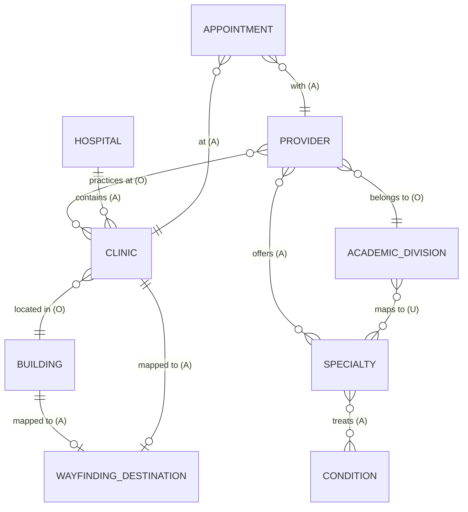
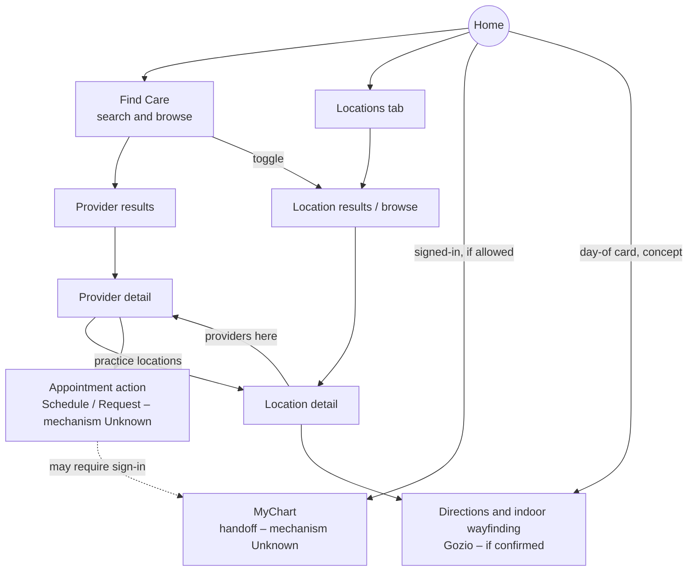

# 3. Experience Architecture – MyCare 2.0

| | |
|---|---|
| **Deliverable** | 3 of 7 – Experience Architecture, including the UX Foundation principles |
| **Status** | Draft v0.1 – **working hypothesis, not a navigation decision** |
| **Date** | Oct. 13, 2026 |
| **Sources** | S1 (current navigation, entity links, proposals); S3–S7 (standards). S2a and S2b were not accessed. |
| **Evidence mix** | The current structure is Observed. The relationships between entities are partly Observed and partly Assumption. Every navigation option is a **Recommendation** for validation. |
| **Key assumptions** | A-03 (Find Care naming), A-05 (MyChart is the system of record), A-07 (Gozio), A-08 (shared data) – see the [Register](05-assumptions-risks-register.md). |
| **Decisions required** | Navigation model (Q-09, Q-12); MyChart boundary (Q-27); Gozio's role (Q-28); account model (Q-29). |

---

## 1. Structural facts and proposals the architecture must respect

| # | Input | Evidence |
|---|---|---|
| 1 | Today's main navigation has five tabs: Home, MyChart, Providers, Locations, Wayfinding | Observed (S1-1, S1-6, S1-13, S1-17) |
| 2 | Another UTSW build or version shows three tabs: Home, Providers, Locations | Observed (S1-14, S1-15); reason Unknown (K-02) |
| 3 | Find a Provider becomes "Find Care", with one prominent search across doctor, specialty, condition, location and zip | Proposed (S1-2); naming is A-03 |
| 4 | Find Care may toggle between providers and sites/clinics | Proposed (S1-2) |
| 5 | Gozio becomes the main way to find and navigate to a location, reachable from Home and integrated into Find Care | Proposed (S1-13) |
| 6 | Providers link to their practice locations; clinics link to their providers; buildings link to their clinics | Observed (S1-8, S1-15) |
| 7 | MyChart tasks are reachable from Home Quick Links and a MyChart tab | Observed (S1-1, S1-17) |
| 8 | Concepts explore a four-icon floating bar (home, search, map, profile) and separate signed-out and signed-in homes | Concept only (S1-17, S1-18) |
| 9 | Settings, favorites, language, accessibility, permissions and insurance card are proposed for an account area | Proposed (S1-24) |

## 2. Core entity model

Patients move between provider and location information. That only works if the underlying objects are related consistently. The model below shows the **minimum** relationships the experience needs.



| Relationship | Evidence | Why it matters |
|---|---|---|
| Provider ↔ Clinic (practice location) | **Observed.** The provider profile lists primary and secondary locations (S1-8). The clinic page lists providers (S1-15). | Journey C; the distance shown on cards; the location-specific appointment action |
| Clinic → Building | **Observed.** "Clinics in Building" (S1-15). Clinic names embed the building ("… at Professional Office Building 2", S1-6). | Patients need both the clinic (department) and the building (where to go) |
| Hospital ↔ Clinic | **Assumption.** "Hospitals" is a separate category (S1-13); whether hospitals contain clinics in the data is Unknown | Browse structure and naming (S6 hospital naming rules) |
| Provider → Academic division | **Observed** (S1-6) | Must keep working internally even if patients see specialties |
| Academic division ↔ Specialty ↔ Condition | **Unknown or Assumption.** Proposed by S1-7. S2c suggests a condition taxonomy on the web (A-17). | Core of Find Care search and browse (U-06) |
| Appointment → Provider / Clinic | **Assumption** (concept, S1-18) | Signed-in home, day-of card and wayfinding to the appointment |
| Building / Clinic → Wayfinding destination | **Assumption** (S1-13, S1-18) | "Take me to my appointment" needs each department mapped to a navigable destination (U-09) |

## 3. Navigation hypotheses

**No navigation decision is made here.** Three hypotheses are compared so the client can choose with evidence (Q-09 usage data, Q-27 MyChart boundary, Q-28 Gozio role).

| | **H1 – Five destinations, reorganized (recommended working hypothesis)** | **H2 – Four destinations (concept-aligned)** | **H3 – Current tabs, improved in place** |
|---|---|---|---|
| Tabs | Home · Find Care · Locations · MyChart · Account | Home · Search (Find Care) · Map (Locations) · Profile | Home · MyChart · Find Care (was Providers) · Locations · Wayfinding |
| What changes | Providers becomes Find Care. Locations and Wayfinding merge into one Gozio-backed "find and navigate" destination. A new Account area holds settings and favorites. | MyChart leaves the tab bar and is reached from Home and Profile | Rename only; find and navigate stay separate |
| Aligns with | S1-2, S1-13, S1-24; keeps MyChart prominent as today (S1-1) | S1-17 and S1-18 concepts | Current app; lowest disruption |
| Main risk | Assumes Gozio can serve both find and navigate (R-04) | Demotes MyChart, a current top-level destination, with no usage evidence (R-11) | Contradicts the S1-13 proposal; no home for settings and favorites |
| Decide with | Q-09, Q-27, Q-28 | Q-09 (MyChart usage share), Q-27 | Q-12 (appetite for change) |

**Why H1 is the working hypothesis:**
- It applies the deck's clearest proposals: Find Care (S1-2) and Gozio as the main find-and-navigate (S1-13).
- It gives the Account proposals a home (S1-24).
- It does not demote MyChart, which is top-level today, without evidence.

It should be re-tested once usage data (Q-09) and the integration answers (Q-27, Q-28) are in.

## 4. Proposed hierarchy (H1, working hypothesis)

```text
UTSW MyCare 2.0
├── Home
│   ├── Signed-out: search entry · Find Care shortcuts (specialties) · Locations shortcut
│   │               · MyChart sign-in / connect · MedBlog and featured content · Patient resources
│   ├── Signed-in (only if U-08 and U-13 allow): upcoming appointment card (week before / day of)
│   │               · MyChart quick tasks · favorites · recommended content
│   └── Contextual: Campus Mode (P3) · seasonal campaign card (P3)
├── Find Care
│   ├── Search: doctor · specialty · condition · location · zip  (+ near me)
│   ├── Browse specialties (patient-friendly taxonomy, U-06)
│   ├── Search history · popular searches (P3)
│   └── Results  [Providers | Locations]  + filters (+ sort, P3)
│       ├── Provider detail → appointment action · call · share · favorite
│       │                    → practice locations → Location detail
│       └── Location detail (shared with the Locations tab)
├── Locations  (find and navigate; Gozio-backed if confirmed)
│   ├── Search: building · clinic · hospital · zip · near me
│   ├── Browse: Hospitals · Clinics · Buildings  (current categories, S1-13)
│   ├── List / map
│   └── Location detail → directions · indoor wayfinding · call · providers here
│                        · clinics in building · favorite
├── MyChart  (handoff; mechanism Unknown – U-08)
│   └── Messages · Test results · Visits · Billing  (current Quick Links, S1-17)
└── Account
    ├── Favorites (providers, locations; content TBD)
    ├── Preferences: language? · accessibility · permissions
    ├── Insurance card (P3) · Personal information? (Hold – may belong in MyChart)
    └── Patient resources · MedBlog and newsroom · Contact and help
```

**Design rule implied by this hierarchy (recommendation):** **one Location detail and one Provider detail.** Each is a single, shared destination wherever it is reached from (Find Care, Locations, Home, an appointment card or a favorite). This keeps information consistent (principle UX-4).

## 5. How Find Care, providers, locations and patient services relate



## 6. Where MyChart and external services fit

| Destination | Current entry (Observed) | Pattern to decide | What must be defined before design | Status |
|---|---|---|---|---|
| MyChart | MyChart tab; Home Quick Links (S1-1, S1-17) | Deep link to the MyChart app, embedded web view, or single sign-on | Ownership after handoff; return path; data MyCare may display; naming (K-08) | Unknown (U-08) |
| Appointment scheduling | "Schedule Now" / "Request an Appointment" (S1-6) | In-app flow, MyChart scheduling, web form or phone | Eligibility rules; sign-in needs; confirmation and return | Unknown (U-07) |
| Gozio wayfinding | Wayfinding tab (S1-1), provider Unknown | Embedded SDK views, a separate module, or deep links to destinations | Coverage by building; branding; offline; parking | Unknown (U-09) |
| Driving directions | Not observed | Hand off to the device's maps app, or Gozio outdoor routing | Which app; consent for location | Unknown |
| Patient resources (web) | Seen on the web only (S1-22) | Native screens or web views | Content ownership; consistency; accessibility of web views | Unknown (U-02, U-16) |
| Food ordering (vendor) | Proposed link (S1-21) | External browser or in-app browser | Vendor policy; privacy; return | Proposed (U-19) |
| Phone calls | Phone numbers on profiles and clinics (S1-8, S1-15) | Native call action | Which number is right for each context (clinic vs. central scheduling) | Observed or Unknown |

**Recommendation:** every handoff should tell the user where they are going ("Opens MyChart") and should let them return to where they were in MyCare.

## 7. Signed-out and signed-in experiences

| Capability | Signed-out | Signed-in | Evidence |
|---|---|---|---|
| Find Care, provider and location detail | Full access | Same; favorites may sync | Recommendation; U-10 |
| Appointment action | Available; may require sign-in at the handoff | Possibly pre-authenticated | Unknown (U-07, U-10) |
| Home | General: search, shortcuts, content, MyChart sign-in | Personal: upcoming appointment, tasks, favorites | Concept (S1-17, S1-18) |
| MyChart tasks | Prompts sign-in | Opens the task | Observed entry; mechanism Unknown |
| Favorites | Stored on the device only (option) | Synced to an account (option) | Unknown (U-10) |
| Search history | Exists today; storage Unknown | Unknown | Observed (S1-1); U-10, U-13 |
| Campus Mode | Generic visitor services | Day agenda | Proposed (S1-21); U-18 |
| Campaign content | Seasonal | Possibly service-line-relevant | Proposed (S1-24); privacy U-13 |

**Open architectural question:** is there a MyCare sign-in at all, or is "signed-in" the same as a MyChart session (Q-29)? H1 works either way, but the account area's contents depend on the answer.

## 8. Moving between provider and location information

**Recommendations, grounded in S1-8, S1-10 and S1-15:**
1. **On a provider profile,** show practice locations as their own section (proposed as a swipeable set, S1-10). Each location opens the shared Location detail.
2. **On a clinic detail,** keep "providers here" (exists as "Search Providers", S1-15). It should filter Find Care rather than open a separate list, so filters stay consistent.
3. **On a building detail,** keep "clinics in building" (exists, S1-15) and add navigation when Gozio coverage exists.
4. **Make appointment actions location-aware** where scheduling requires it (Q-26). Patients should know which location they are booking.
5. **For providers with several locations,** the distance shown on result cards needs a rule – for example, the nearest location (Q-24).

## 9. Global vs. contextual capabilities

| Global – reachable from anywhere (recommendation) | Contextual – appear where they are relevant |
|---|---|
| Search entry into Find Care | Appointment action (provider detail, results) |
| Access to MyChart | Directions and indoor wayfinding (location detail, appointment card) |
| Locations | Call (provider detail, location detail, Campus Mode Guest Services) |
| Account (favorites, preferences, help) | Share and favorite (provider and location detail) |
| Emergency guidance – **if** the client confirms it is needed (Q-18) | Appointment cards (signed-in home, when an appointment exists) |
| | Campus Mode (on campus, when triggered – U-18) |
| | Campaign cards (seasonal) |

---

## 10. UX foundation principles (preliminary)

Each principle separates **Existing standard** (a provided UTSW source), **Grounding** (what the deck shows or proposes) and **Recommendation** (this team's proposal, for validation). **No compliance with any accessibility or regulatory standard is claimed.**

### UX-1 Patient-first language
- **Existing standard:** S6 governs names, titles, abbreviations and formatting. Examples include "Dr. Doe" on second reference, spelled-out hospital names, and no em dashes.
- **Grounding:** "Instead of academic division use more patient friendly terms like specialty" (S1-7).
- **Recommendation:**
  - Show patient-facing specialty names, with synonyms and condition terms used in search.
  - Keep academic division as internal metadata, or as secondary text on the detail page.
  - Write calls to action as plain verbs that say what will happen.
- **Validate:** taxonomy owner (Q-14); S6 compliance review with CMPA.

### UX-2 Clear search and discovery
- **Grounding:**
  - Large search bar as the main feature (S1-2).
  - Specialty icons (S1-2).
  - "Popular searches?" (S1-2).
  - Search history (S1-1).
- **Recommendation:**
  - One search entry with clear examples of what can be searched.
  - Browse by specialty as an equal alternative to typing.
  - Every results screen should explain what is shown and how to widen it.
  - Consider whether urgent and emergency guidance is needed at the entry point (Q-18) – not in the deck.
- **Validate:** search capabilities (Q-25); search logs (Q-08).

### UX-3 Reduced cognitive load
- **Grounding:**
  - "Thinking less is more for this view and let the filters do the work" (S1-7).
  - "expanding section vs. a scroll down experience" (S1-10).
  - Raw research text (S1-9).
- **Recommendation:**
  - Progressive disclosure: summary first, detail on demand.
  - Cards limited to the information needed to choose.
  - Long research lists summarized, with full detail available.
- **Validate:** usability testing in Phase 4.

### UX-4 Consistent provider and location information
- **Existing standard:** S6 phone, time, date and naming rules.
- **Grounding (Observed inconsistencies):**
  - Phone numbers formatted "(817) 882-2450" vs. S6's 214-648-8400 style.
  - Mixed address formats.
  - Hyphenated specialty names (S1-6, S1-8, S1-14).
- **Recommendation:**
  - One content model and one formatting rule set for providers and locations.
  - One shared detail destination for each (section 4).
  - Agreed display-name rules for long clinic names (R-10).
- **Validate:** with CMPA and the data owners (Q-24).

### UX-5 Clear and trustworthy appointment actions
- **Grounding:** "Schedule Now" vs. "Request an Appointment" (S1-6); "More action type buttons" (S1-7, S1-10).
- **Recommendation:**
  - Use one action model.
  - Labels must describe the actual outcome (book now, send a request, or call).
  - Set expectations before handoff: whether sign-in is needed, which location, and what happens next.
  - Never show an action that cannot be completed.
- **Validate:** scheduling rules (Q-15, Q-26).

### UX-6 Accessibility and inclusive design
- **Existing standard:**
  - Brand colors are defined (S3).
  - UT Southwestern Blue `#004278` on white has a contrast ratio of about 10.2:1 (computed).
  - **No accessibility standard is included in the materials provided** (U-12).
- **Grounding:**
  - "Accessibility settings" and "Languages" (S1-24, S1-2).
  - Light-blue text and buttons in current screens may have low contrast. This is a visual impression, not measured (S1-6, S1-8).
- **Recommendation:**
  - Pick a target standard with UTSW Compliance (Q-30).
  - Support device text size, screen readers and reduced motion.
  - Never use color as the only way to convey meaning.
  - Use inclusive filter labels (for example, how the provider-gender filter is worded).
  - Audit the current app.
- **Validate:** Q-11, Q-30.

### UX-7 Privacy and appropriate handling of sensitive information
- **Existing standard:** none provided (U-13).
- **Grounding:** the concept shows a patient's name, location, provider, specialty and visit type on the home screen (S1-18). Search history (S1-1) and insurance card storage (S1-24) also involve sensitive information.
- **Recommendation:**
  - Show the minimum necessary by default, especially on lock-screen-visible or shared surfaces.
  - Keep sensitive searches private.
  - Ask for permissions in context.
  - Review analytics and third-party SDKs before launch.
- **Validate:** Privacy Office and InfoSec (Q-31).

### UX-8 Consistent navigation across integrated experiences
- **Grounding:** MyChart, Gozio, scheduling, web resources and vendor links (S1-1, S1-13, S1-21, S1-22).
- **Recommendation:**
  - Use predictable handoff cues and return paths (section 6).
  - Keep shared terminology across MyCare, MyChart and Gozio.
  - Keep the visual identity consistent where the vendor allows it.
- **Validate:** Q-27, Q-28.

### UX-9 Responsive layouts and mobile usability
- **Grounding:** iOS phone screenshots only (A-16). Platform and tablet scope are Unknown (U-01).
- **Recommendation:**
  - Layouts must survive large text sizes, small phones and, if in scope, tablets and Android.
  - Keep primary actions within thumb reach.
  - Design for one-handed use on the move (walking to an appointment).
- **Validate:** Q-22.

### UX-10 Clear loading, empty, error and permission states
- **Grounding:** the empty favorites state appears only in a reference (S1-23). No states are defined for UTSW.
- **Recommendation:** define these states for every core screen:
  - Loading.
  - No results, with a way to widen the search.
  - Partial data, such as a missing photo or no hours.
  - Location permission denied, falling back to zip (which exists today, S1-1).
  - Offline (for example, in garages).
  - Handoff failure (MyChart or scheduling unavailable).
  - Closed or temporarily unavailable location.
- **Validate:** data availability (Q-24); integration error behavior (Q-26 to Q-28).

### Brand and editorial principle (from S3–S7)
- **Existing standard:**
  - UT Southwestern Blue is the primary color.
  - The logo is used only as supplied art and is never recreated in type.
  - S6 editorial rules apply.
- **Recommendation:**
  - Get an approved MyCare app lockup and icon from CMPA before visual design (Q-32).
  - Restyle every inspiration reference into the UTSW palette.

---

## 11. Assumptions and decisions required for this deliverable

| Item | Type | Reference |
|---|---|---|
| H1 is a working hypothesis, chosen for structuring work only | Decision required | Q-09, Q-12 |
| Gozio can serve both "find" and "navigate" for locations | Assumption | A-07, Q-28 |
| MyChart stays top-level until usage data says otherwise | Recommendation | Q-09, Q-27 |
| An Account area exists even for signed-out users (preferences, favorites on the device) | Recommendation | Q-29 |
| Single shared provider and location detail destinations | Recommendation | UX-4 |
| Whether emergency guidance must be globally available | Decision required | Q-18 |
