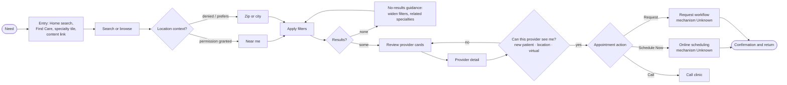
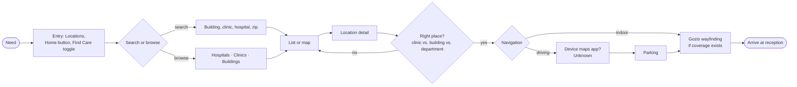
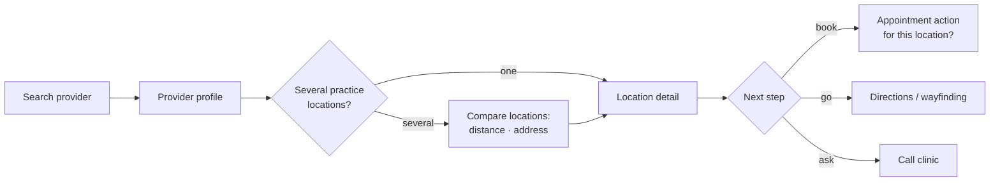
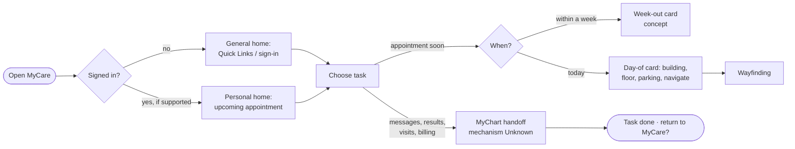

# 4. User Journey Maps – MyCare 2.0

| | |
|---|---|
| **Deliverable** | 4 of 7 – User Journey Maps |
| **Status** | Draft v0.1 – **journey hypotheses, not confirmed workflows** |
| **Date** | Oct. 13, 2026 |
| **Sources** | S1 (current screens and proposals); S6 (naming and format rules). No user research or analytics were provided (U-11). S2a and S2b were not accessed. |
| **Evidence mix** | The stages are Assumptions built from the brief's journey outlines. Each stage marks what is Observed today (O), what is Proposed in S1 (P), and what is Unknown (U). |
| **Key assumptions** | A-02 (audiences), A-04 (appointment actions), A-05 (MyChart), A-07 (Gozio) |
| **Decisions required** | Which journeys matter most for the first release (Q-12); appointment rules (Q-15, Q-26); MyChart and Gozio boundaries (Q-27, Q-28) |

**How to use these maps:**
- Each journey lists the stages, the decision points, the states that must be designed, the dependencies and the **missing steps**.
- The missing steps are things the materials do not address but a real patient would meet.
- They should be validated with patients and staff in Phase 4 before any screen design.

---

## Journey A – Find Care

**Need:** "I need care for something (a condition, a symptom, a specialty, a named doctor) and I want to book it."
**Primary user:** prospective or new patients; existing patients seeking a new specialist (A-02).

| Stage | User goal | Today (evidence) | Proposed or hypothesis | Decision points and states | Dependencies |
|---|---|---|---|---|---|
| 1. Entry | Start looking for care | Providers tab; "Specialties" list (O, S1-1) | Home search; Find Care; specialty icons; popular searches (P, S1-2) | Whether the person is in an emergency (not covered – Q-18) | Navigation decision (H1–H3) |
| 2. Search or browse | Express the need in their own words | "Name, Specialty, Condition" field (O, S1-1) | Search for doctor, specialty, condition, location and zip (P, S1-2) | Ambiguous terms (one condition, several specialties); misspellings; typeahead states | Search service (U-05); taxonomy (U-06) |
| 3. Location context | Find care near me | "Distance from me" button and zip field (O, S1-1) | Distance ranges (P, S1-2) | Permission granted, denied or limited; outside the service area | Location permission (F-23); coordinates (U-04) |
| 4. Filter | Narrow to providers who fit | City only (O, S1-1) | Gender, languages, online scheduling, affiliation, distance, accepting new patients, provider type (P, S1-2; K-01) | Too many or too few results; filters with missing data; clearing filters | Provider attributes (U-03); affiliation rules (U-17) |
| 5. Review results | Scan and shortlist | Card with photo, name, division, address, distance and action (O, S1-6) | Action-first, specialty-based, less information (P, S1-7) | Distance for providers with several locations; "not accepting" display | Taxonomy (U-06); action rules (U-07) |
| 6. Compare | Weigh a few options | **No compare capability observed or proposed** | Gap. Favorites (F-19) may partly support it. | Moving back and forth between results and profiles | – |
| 7. Select provider | Confirm this is the right person | Long profile (O, S1-8, S1-9) | Sections, actions, swipeable locations (P, S1-10) | Which location; in-person or virtual ("Accepting Virtual Care", O, S1-8) | Profile content (U-03, U-16) |
| 8. Appointment action | Book or request | "Schedule Now" or "Request an Appointment" (O, S1-6, S1-8) | Kept (P, S1-7, S1-10) | New vs. existing patient; referral needed; sign-in needed; insurance; slot availability; handoff failure | Scheduling (U-07); MyChart (U-08); authentication (U-10) |
| 9. Confirm and return | Know it worked and what's next | **Unknown** | Gap | Confirmation visibility; return to MyCare; reminders | U-07, U-22 |

**Alternative paths:**
- **Known provider name** goes straight from Search to Provider detail.
- **Content-led:** MedBlog article → specialty → results (Assumption; F-28, F-29).
- **Location-led:** Find Care toggle → clinic → "providers here" (P, S1-2; O, S1-15).
- **Calling** instead of booking online.

**Missing steps (not in the materials):**
- Urgent or emergency triage.
- Insurance acceptance.
- Referral requirements.
- Caregiver booking for someone else.
- Confirmation and what happens next.
- What happens when the chosen provider is not accepting new patients.

---

## Journey B – Find a Location

**Need:** "I need to find a hospital, clinic or building, and get there."
**Primary user:** patients with upcoming visits; visitors; people looking for a nearby clinic.

| Stage | User goal | Today (evidence) | Proposed or hypothesis | Decision points and states | Dependencies |
|---|---|---|---|---|---|
| 1. Entry | Start finding a place | Locations tab; Wayfinding tab (O, S1-1, S1-13) | Home button; integrated into Find Care; Gozio as the main find-and-navigate (P, S1-13) | Which entry the user expects | Navigation decision; Gozio (U-09) |
| 2. Search or browse | Locate a specific place or category | "Building, Clinic or Hospital" field and zip; Buildings / Clinics / Hospitals (O, S1-13); variant Clinics/Maps (O, S1-14) | Not specified | The difference between building, clinic and hospital may be unclear to patients (Assumption); no results | Location data (U-04) |
| 3. Review | Pick from a list or map | Clinic list with address and phone; map pins (O, S1-14) | Not specified | Map vs. list; permission for "near me" | U-04, U-09 |
| 4. Location detail | Confirm it's the right place | Building → clinics; clinic → providers, phone (O, S1-15) | References show hours, open status and "Take Me There" (R, S1-15) | Closed or temporarily closed; missing hours; phone number selection | Hours and status data (U-04) |
| 5. Identify the right clinic or department | Go to the correct floor and suite | Clinic names embed the building and floor or suite in the address (O, S1-6, S1-8) | Day-of concept shows building, floor, suite and reception (R, S1-18) | Several clinics in one building; similar names (R-10) | Clinic ↔ building ↔ destination mapping (U-09) |
| 6. Directions and navigation | Get there | Wayfinding tab, provider Unknown (O, S1-1) | Gozio navigation (P, S1-13) | Driving vs. indoor; parking; offline; Gozio coverage gaps | Gozio (U-09); device maps handoff (Unknown) |
| 7. Arrive | Check in | Arrival dialog seen in S1-22, source Unknown | Not proposed | Late arrival; wrong building | Unknown (F-38) |

**Missing steps:**
- Parking guidance, which appears in the concept only.
- Accessibility routing (step-free routes).
- Hospital visiting information.
- What to do if a location is closed.
- Which phone number to call.

---

## Journey C – Provider to Location

**Need:** "I've found the provider I want; where do I go, and can I book there?"

| Stage | User goal | Today (evidence) | Proposed or hypothesis | Decision points and states | Dependencies |
|---|---|---|---|---|---|
| 1. Provider profile | Understand the provider | Profile with primary and secondary locations (O, S1-8) | Locations as their own swipeable section (P, S1-10) | – | U-03 |
| 2. Choose a location | Pick where to be seen | Location blocks with address and phone (O, S1-8) | Action buttons for directions, address and phone (P, S1-10) | Which location offers the right visit type; which is nearest | Location–provider data (U-03, U-04) |
| 3. Location detail | Understand the place | Building and clinic details (O, S1-15) | Shared Location detail (Recommendation) | Hours; open status; parking | U-04 |
| 4a. Book | Schedule at that location | The appointment action is provider-level today (O, S1-6) | Unknown whether scheduling binds to a location | Location-specific availability | U-07 |
| 4b. Navigate | Get there | Wayfinding tab (O) | Gozio (P) | Coverage | U-09 |

**Missing steps:**
- Whether the appointment action is tied to a specific location.
- How distance is calculated when a provider has several locations.
- How to explain a location that is a clinic inside a hospital building.

---

## Journey D – Returning Patient

**Need:** "I'm already a UTSW patient – I want to see my appointment, message my doctor, check results or pay a bill."

| Stage | User goal | Today (evidence) | Proposed or hypothesis | Decision points and states | Dependencies |
|---|---|---|---|---|---|
| 1. Open the app | Get to my task fast | Home with MedBlog, Quick Links, Resources (O, S1-17) | Signed-in home (R, S1-18) | Signed in or not; session expired | Authentication (U-10) |
| 2. Find the relevant task | See what matters now | Quick Links: Message your doctor, Get your test results, Manage Your Visits, Manage Billing (O, S1-17) | Upcoming appointment card; follow-up prompt (R, S1-18) | No upcoming appointments (empty state); several appointments | MyChart / Epic data (U-08) |
| 3. Access the service | Open the task | MyChart tab and Quick Links (O) | "MyChart Portal – Connect now" (R, S1-17) | MyChart app installed or not; sign-in; outage | U-08 |
| 4. Day of visit | Arrive on time at the right place | Wayfinding tab (O) | Day-of card with building, floor, suite, parking and "Take me to my appointment" (R, S1-18) | Appointment changed or cancelled; location not mapped in Gozio | U-08, U-09, U-04 |
| 5. Complete and return | Finish and come back | **Unknown** | – | Return path after MyChart | U-08 |

**Missing steps:**
- Caregiver or proxy access to someone else's appointments.
- Rescheduling, which appears in the concept only.
- Notification consent.
- Privacy of visit details on screen (U-13).

---

## Journey E – Supporting Experiences

These are shorter journeys. Each is **Proposed** in S1 or seen in a reference, and needs scope confirmation (Q-12).

| Sub-journey | Flow (hypothesis) | Evidence | Decision points and states | Dependencies | Missing or unknown |
|---|---|---|---|---|---|
| **E1 – Learn** | Home or MedBlog → article or condition/service page → related specialty → Find Care | MedBlog (O, S1-20); "learn more about services, conditions, specialties" (P, S1-23) | Content type; offline reading; sharing | Content feed (U-16) | Newsroom is not shown; how content links to care is not defined |
| **E2 – Save** | Provider or location detail → favorite → Account → Favorites | P (S1-23, S1-24); reference empty state (S1-23) | Sign-in required?; empty state; removing a favorite | Account model (U-10) | Whether content can be saved; sync across devices |
| **E3 – Patient resources** | Home or Account → Patient Resources → topic (Appointments, Billing and Insurance, Medical Records, Guest and Patient Services, Support Services, Clinical Trials, Patient Assistance Office) | O (web, S1-22) | Native screen vs. web view; return path | U-02, U-16 | No annotation; in-app scope Unknown |
| **E4 – Preferences** | Account → language, accessibility, permissions, insurance card, personal info | P (S1-24; some items carry "?") | Overlap with MyChart; device vs. app settings | U-10, U-13, U-20, U-21 | Which settings exist and where they are stored |
| **E5 – Campus services** | On campus → Campus Mode → agenda, Guest Services call, food ordering, wayfinding, entertainment | P (S1-21) | Trigger (location, check-in, manual); inpatient vs. visitor | U-18, U-19, U-09 | Audience; agenda data source; meaning of "entertainment" |
| **E6 – Seasonal campaigns** | Home → campaign card → content → related service or Find Care | P (S1-24); reference promo card (S1-19) | Personalization limits | U-16, U-13 | Curation owner; calendar conflicts (K-06) |

---

## Cross-journey states to design (applies to all journeys)

| State | Where it applies | Status |
|---|---|---|
| Loading and slow network | All data screens | Recommendation |
| No results, with a way to widen the search | Find Care, Locations | Recommendation |
| Partial data (no photo, no hours, no languages) | Provider and location cards and details | Recommendation; depends on U-03, U-04 |
| Location permission denied or limited | Find Care, Locations, Campus Mode | Recommendation; zip fallback exists today (O, S1-1) |
| Offline | Wayfinding, day-of card | Recommendation |
| Handoff failure (MyChart, scheduling, Gozio, vendor) | Journeys A, B, D, E5 | Recommendation |
| Session expired or signed out | Journey D, favorites | Recommendation |
| Closed or temporarily unavailable location or provider | Journeys B, C | Reference shows a closure notice (R, S1-15) |
| Empty states (favorites, appointments, history) | Journeys D, E2 | Reference (R, S1-23) |
